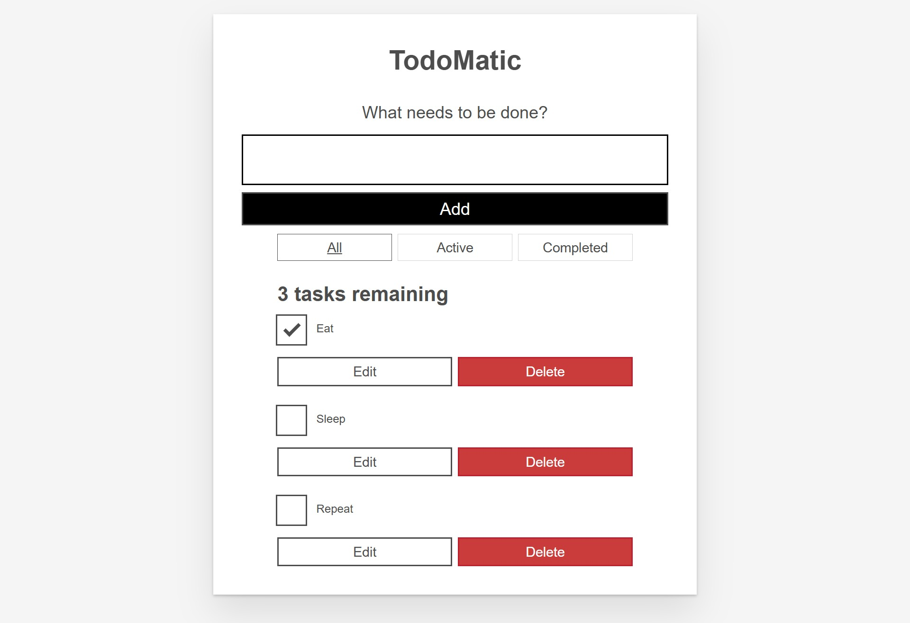
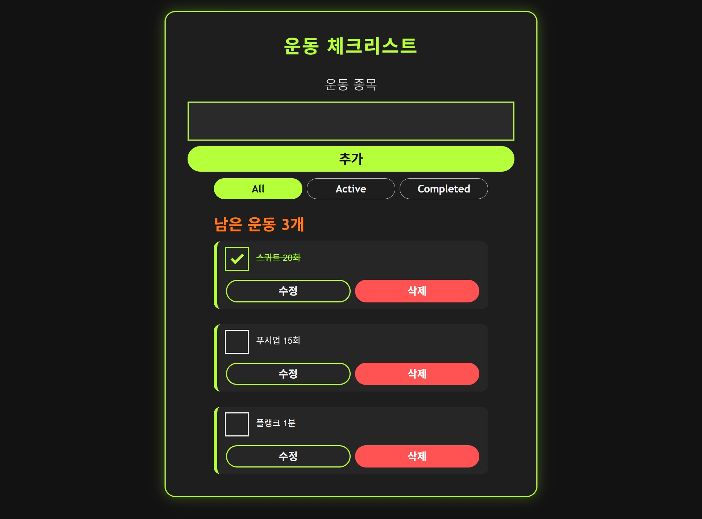

# todo-react

Sample todo app built with the React/ReactDOM framework. For the accompanying documentation, see
[Understanding client-side JavaScript frameworks
: React tutorials](https://wiki.developer.mozilla.org/en-US/docs/Learn/Tools_and_testing/Client-side_JavaScript_frameworks#React_tutorials).

For the live version, see https://mdn.github.io/todo-react/.

This project was bootstrapped with [Create React App](https://github.com/facebook/create-react-app).

## Getting started

To get this app running locally, you'll need to have [Node.js](https://nodejs.org/en/) and [Yarn](https://yarnpkg.com/getting-started/install) installed on your machine.
In the project directory, you can run:

```bash
yarn && yarn start
```

More information about the available commands can be found in the [Contributing](CONTRIBUTING.md) guide.

## Learn More

You can learn more in the [Create React App documentation](https://facebook.github.io/create-react-app/docs/getting-started).

The following sections are recommended:

- [Code Splitting](https://facebook.github.io/create-react-app/docs/code-splitting)
- [Analyzing the Bundle Size](https://facebook.github.io/create-react-app/docs/analyzing-the-bundle-size)
- [Making a Progressive Web App](https://facebook.github.io/create-react-app/docs/making-a-progressive-web-app)
- [Advanced Configuration](https://facebook.github.io/create-react-app/docs/advanced-configuration)
- [Deployment](https://facebook.github.io/create-react-app/docs/deployment)
- [npm run build fails to minify](https://facebook.github.io/create-react-app/docs/troubleshooting#npm-run-build-fails-to-minify)

To learn React, check out the [React documentation](https://reactjs.org/).

## Contributing

Our project welcomes contributions from any member of our community.
To get started contributing, please see our [Contributor Guide](CONTRIBUTING.md).

By participating in and contributing to our projects and discussions, you acknowledge that you have read and agree to our [Code of Conduct](CODE_OF_CONDUCT.md).

## License

This project is licensed under the [LICENSE](LICENSE).


# Project Information: 
- 프로젝트 소개: To do list - 할일 정해서 기입해서 체크하고 변경할 수 있는 프로젝트
- 선택 이유: 원래 헬스 관련 루틴 관리 프로젝트를 찾으려 했으나 마땅한게 없어서 기본 프로젝트에서 운동 루틴 관리로 바꾸기 쉬운 일반 Todo 프로젝트를 선택했습니다.
- 원본 GitHub URL 및 라이선스: https://github.com/mdn/todo-react, MPL-2.0 (라이선스 파일 존재)
# Installation: 
- 설치·실행 방법: fork로 개인레포에 저장했고 클론 떴습니다. 이후 ai의 도움을 받아 기본 세팅 후 필요한 github 주소를 연결했고 npm install, npm run dev 진행했습니다.
- 실행 화면: 
# Source Code Exploration: 주요 파일, 컴포넌트, 코드 분석
## Project Structure: 주요 파일 2~3개의 역할
- main.jsx: data를 <App tasks={DATA} />로 주고 root에 렌더링한다. 초기 데이터 또한 여기에 있다.
- Form.jsx: 입력창과 add 버튼 관리
## React Component: 주요 컴포넌트 1~2개의 역할
- Form/: 새 정보를 입력받는 컴포넌트이다. 
## Code Analysis: 코드 1개(약 5~15줄)를 선택하여 동작 원리 설명
-   function toggleTaskCompleted(id) {
    const updatedTasks = tasks.map((task) => {
      if (id === task.id) {
        return { ...task, completed: !task.completed };
      }
      return task;
    });
    setTasks(updatedTasks);
  }
체크박스에 체크한 항목의 id를 받아 새로운 배열을 만들고  if (id === task.id) 로 사용자가 선택한 항목만 선택 이후 나머지는 유지하면서 complted만 !로 변경 이후 react에 변경된 상태 등록후 화면에 표시
# Customizing: 
- 수정한 3가지 내용
1. Text: 기존 영어로 작성되어 있던 제목, 설명, 버튼등을 한국어로 바꾸고 운동 루틴 관리 프로젝트에 맞게 문구 변경
2. Style: 헬스 관련 프로젝트의 정체성에 맞게 어두운 톤으로 가시성 있게 변경, 기존 딱딱하고 각진 폼에서 둥근 폼으로 변경
3. UI/Data: 기존 데이터를 운동 데이터로 변경
- 수정 파일명: src/App.jsx, src/components/Form.jsx, src/components/Todo.jsx, src/index.css, src/main.jsx
- 전/후 결과
|  |  |

# Deployment: 
- 실제 접근 가능한 Vercel URL: https://todo-react-azure-chi.vercel.app
# Weekly Review:
- 새롭게 배운 내용 3가지
1. React의 큰 틀을 배울 수 있었습니다.
2. React에서 컴포넌트의 분리 구조와 그 구조 사이에서 상위에서 하위로 데이터를 내려주고 자식 컴포넌트에서 일어난 이벤트를 부모 함수를 호출해 전달하는 흐름을 배울 수 있었습니다.
3. 객체나 배열을 직접 수정하는 것이 아니라 ... 이나 map으로 새로운 배열을 만들어 처리해야된다는 것을 배웠습니다.
- 어려웠던 점과 해결 방법
step 3에서 주요 파일, 컴포넌트, 코드를 분석해 설명하는 것이 어려웠습니다. 초반에 react의 큰 틀과 흐름을 이해하는데 조금 어려움이 있었고 ai를 통해 계속 모르는 것을 물어보며 차근차근 하나씩 알아갔습니다.
- AI 활용 내용 및 느낀 점
1. 적절한 react 프로젝트를 찾는데 사용
2. 선별한 프로젝트의 흐름과 코드 내용 설명
3. 초반 세팅 도움
4. 작성 코드 오류 분석 및 디버깅 도움
- 최대한 ai 의존도를 줄이려고 노력중에 있지만 여전히 ai 없으면 과제를 진행하는 데에 있어서 매끄럽게 진행될 것 같지가 않습니다. ai가 없던 시절에 코딩 하신 분들이 정말 대단한 것 같고 ai 의존도를 더욱 줄이려고 한번 노력해보겠습니다.